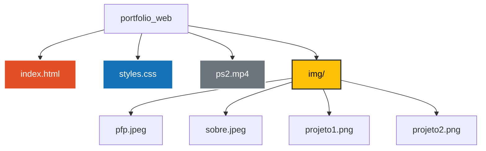

# Meu Portfólio 👨‍💻🚀


> Bem-vindo ao meu espaço na web! ☕ Aqui eu centralizo minha trajetória profissional, minhas habilidades e os projetos que fiz até agora.

---

## 💻 Sobre o Portfólio

Esse é o repositório do meu **Portfólio Web**, que funciona basicamente como meu hub próprio e currículo interativo. O objetivo principal é compartilhar um pouco sobre quem eu sou, as tecnologias que uso e mostrar meus projetos em um só lugar.

A ideia foi montar um espaço com a minha cara: um design moderno e nostálgico (com a animação da tela inicial do PS2), direto ao ponto e com foco em uma experiência legal para o usuário.

---

## ⚙️ Funcionalidades

- **Design Responsivo:** Layout que se adapta perfeitamente, seja no celular, tablet ou monitor ultrawide (PC).
- **Vitrine de Projetos:** Uma galeria com meus projetos (com um adicional de que o próprio usuário pode testar qualquer projeto no próprio navegador!).
- **Radar de Habilidades:** Um resumo das tecnologias que uso nos meus projetos, passando por desenvolvimento, qualidade e automação.
- **Navegação Suave:** Aquele *smooth scroll* bacana entre as seções para deixar a navegação mais fluida.

---

## 🛠️ Tecnologias Utilizadas

- **HTML5:** O corpo do projeto, tudo estruturado bonitinho e focado em acessibilidade.
- **CSS3:** Pra deixar tudo com um visual bacana! Uso de Flexbox, Grid e animações para dar vida à página.
- **JavaScript (ES6+):** 
  - Para dar aquele toque de interatividade, como o menu responsivo e os efeitos de rolagem.
  - Manipulação de elementos na tela para deixar a experiência mais dinâmica.
  - Integração com a API do WhatsApp para envio de mensagens direto do formulário de contato.

---

## 🌎 Dá uma olhada em como ficou! 

- **Acessar Portfólio:** [VEJA MEU PORTFÓLIO NO SEU NAVEGADOR!](https://alicesilva2012.github.io/portfolio/)

---

## 🚀 Como Executar o Projeto Localmente

Para visualizar o portfólio diretamente na sua máquina, siga os passos abaixo.

### Pré-requisitos
- Um navegador web moderno (Google Chrome, Firefox, Edge, etc.).
- [Git](https://git-scm.com) instalado na máquina.
- Um editor de código, como o [VS Code](https://code.visualstudio.com/) (opcional).

### ☕ Passo a Passo

1. **Clone este repositório:**
   ```bash
   git clone https://github.com/AliceSilva2012/portfolio.git
   ```


---

## 📂 Estrutura do Projeto


