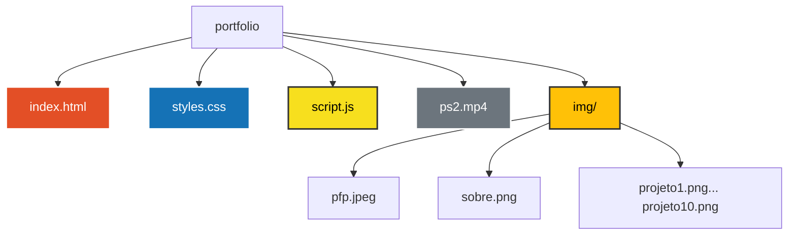

# 🚀 Meu Portfólio Web | Alice Silva Pereira


> Bem-vindo ao meu espaço na web! ☕ Aqui centralizo minha trajetória profissional, minhas habilidades e os projetos que desenvolvi até agora.

---

## 💻 Sobre o Portfólio

Esse é o repositório do meu **Portfólio Web**, que funciona como meu Hub próprio e currículo interativo. O objetivo principal é compartilhar minha evolução técnica: desde a construção de interfaces front-End até o desenvolvimento **Full-Stack** (+back-end), projetos com **Node.js**, consumo de APIs de IA e esteiras de testes automatizados com **CI/CD via GitHub Actions**.

A página possui uma identidade visual única e nostálgica (com aquela animação de fundo da tela inicial do PS2), focada em proporcionar uma navegação fluida e agradável.

---

## ⚙️ Funcionalidades

- **Mini Terminal Interativo (CLI Web):** Janela estilo linha de comando incorporada para executar comandos como `help`, `sobre`, `skills`, `projetos`, `github` e `clear`(ou `limpar`, que faz referência ao comando 'clear' do terminal).
- **Filtro Dinâmico de Projetos:** Permite filtrar a galeria em tempo real por categorias (*Todos*, *Full-Stack & IA*, *Back-End & CI/CD* e *Front-End*) para melhor navegação do usuário.
- **Design Responsivo:** Layout adaptativo usando CSS Grid e Flexbox para celular, tablet e monitores ultrawide.
- **Tags de Identificação:** Etiquetas coloridas destacando a stack e o foco de cada projeto.
- **Contato Direto via WhatsApp:** Formulário de envio de mensagens integrado à API do WhatsApp.
- **Navegação Suave:** Efeito de *smooth scroll* ao navegar entre as seções.

---

## 🛠️ Tecnologias Utilizadas

- **HTML5:** Estrutura semântica, formulários e integração de elementos multimídia (vídeo de fundo).
- **CSS3:** 
  - Layouts adaptativos com **Flexbox** e **CSS Grid** (`auto-fill`).
  - Animações e efeitos em *glassmorphism* (efeito de vidro).
- **JavaScript (ES6+):**
  - Manipulação de DOM e filtragem dinâmica de elementos sem recarregar a página.
  - Lógica de captura de eventos de teclado (`keydown`) e processamento de comandos para o Mini Terminal.
  - Formatação e redirecionamento de mensagens via API do WhatsApp.
- **Versionamento & Ferramentas:** Git, GitHub, VS Code.

---

## 🌎 Teste meu portfólio no seu navegador!

- **Dá uma olhada:** [VEJA ESTE PROJETO NO SEU NAVEGADOR!](https://alicesilva2012.github.io/portfolio/)

---

## 🚀 Como Executar o Projeto Localmente

### Pré-requisitos
- Um navegador web moderno (Google Chrome, Firefox, Edge, etc.).
- [Git](https://git-scm.com) instalado na máquina.
- Um editor de código como o [VS Code](https://code.visualstudio.com/) (opcional).

### ☕ Passo a Passo

1. **Clone este repositório:**
   ```bash
   git clone [https://github.com/AliceSilva2012/portfolio.git](https://github.com/AliceSilva2012/portfolio.git)

2. **Acesse a pasta do projeto:**
   ```bash
   cd portfolio
   ```

3. **Execute a aplicação:**
   - Dê um duplo clique no arquivo index.html para abri-lo no navegador, ou
   - Clique com o botão direito no index.html e selecione Open with Live Server.

---

## 📁 Estrutura do Arquivo


